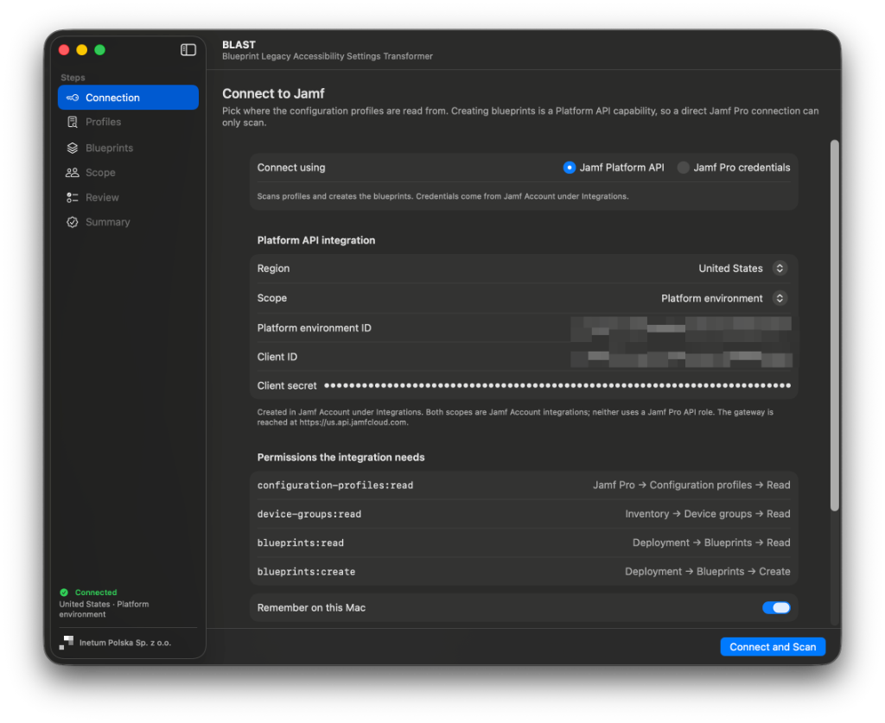
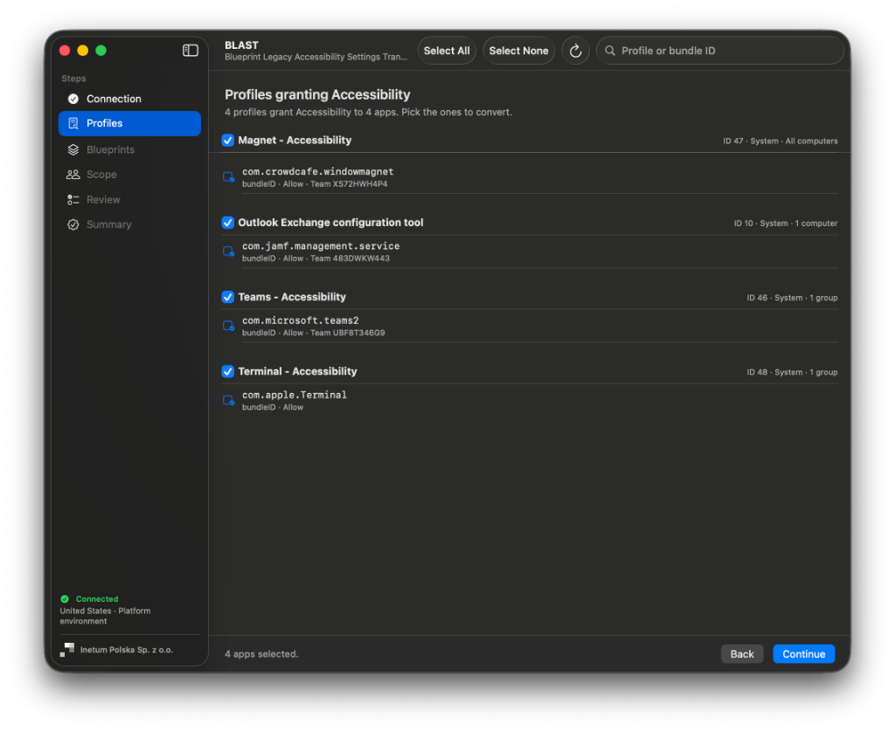
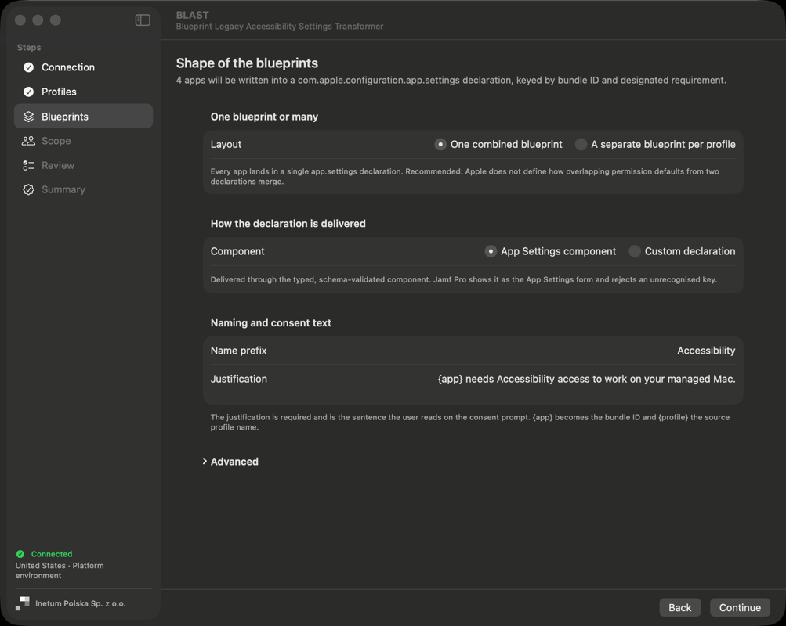
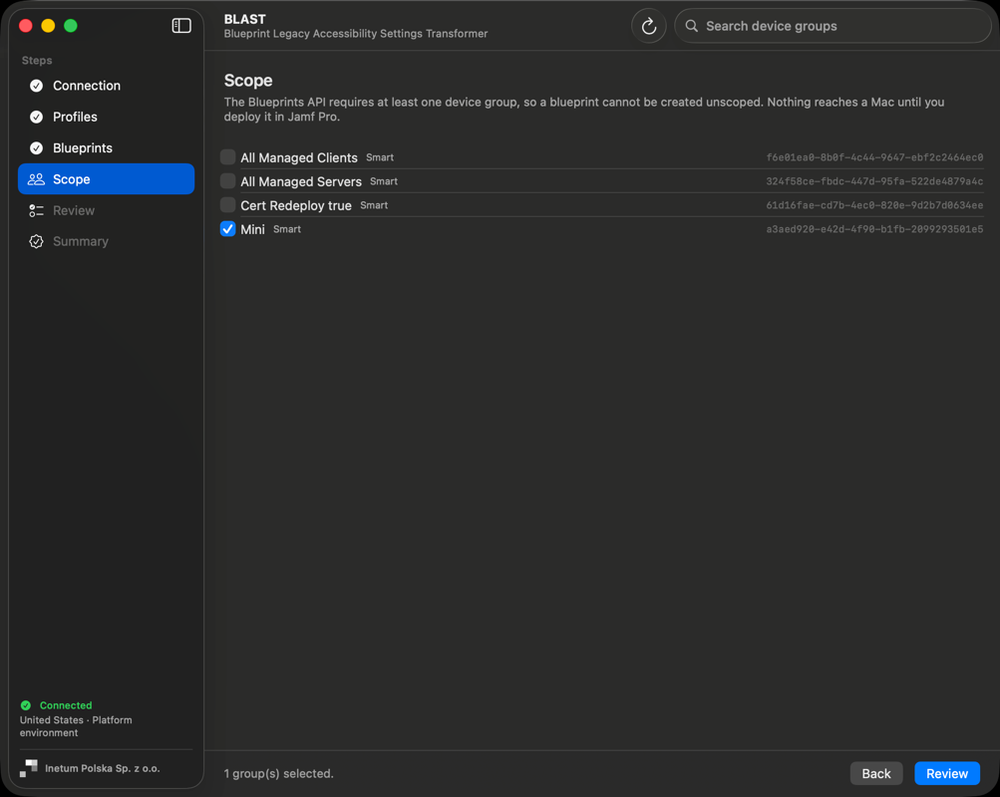
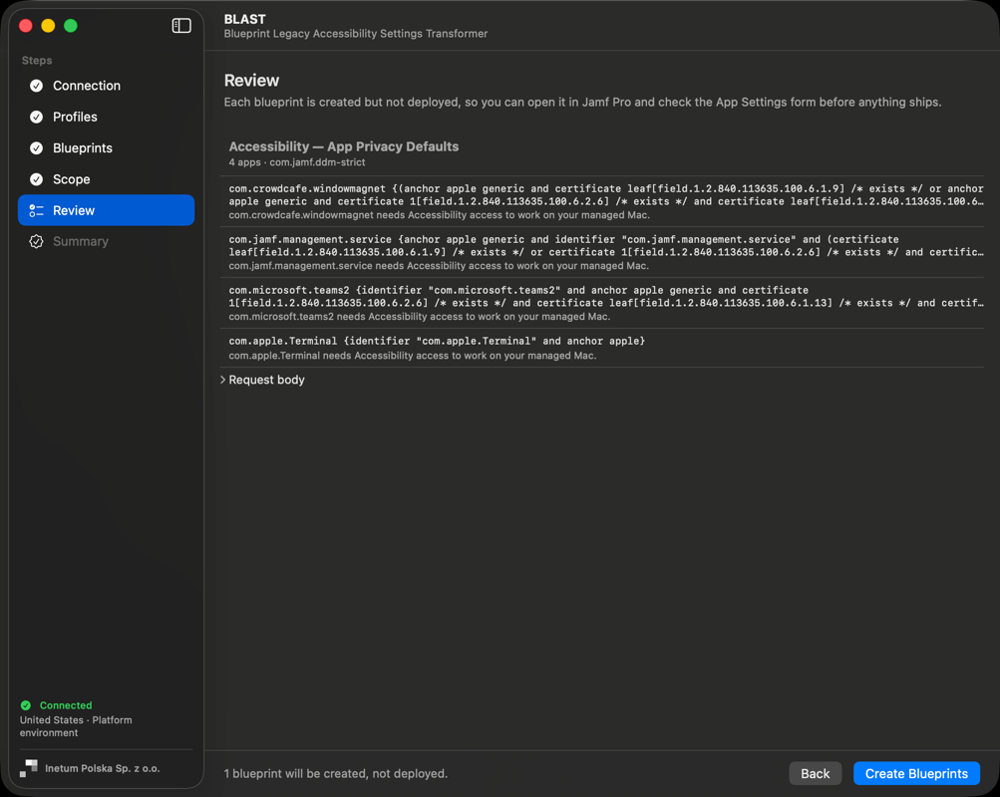

# BLAST

**Blueprint Legacy Accessibility Settings Transformer**

A macOS utility that migrates **PPPC Accessibility grants** out of Jamf Pro configuration profiles and into **Declarative Device Management blueprints**.

Instead of hunting through payloads, rewriting `app.settings` JSON by hand, and hoping two overlapping declarations still merge, BLAST scans the tenant, maps each app, and creates the blueprints for you.

Because Accessibility is leaving MDM profiles —  
**and macOS 27 will not wait.**

---

# The problem

Apple deprecated granting Accessibility through the `com.apple.TCC.configuration-profile-policy` payload in **macOS 26.2**, and **removed it in macOS 27**.

The replacement is the `Privacy.PermissionDefaults` key in `com.apple.configuration.app.settings`. On a Mac that means:

- supervised devices, **macOS 27+**
- the **user channel** (an MDM-enabled local user)
- a composed identifier: `BundleID {Designated Requirement}`
- a required **OrganizationJustification** shown on a single consent prompt
- **no silent grant** — the user still has to choose Allow

Jamf Pro now delivers that declaration through Blueprints (the typed **App Settings** component). PPPC profiles still work on older macOS, so a fleet in transition ends up with both.

BLAST is the bridge between those two worlds.

---

# When to use BLAST

Reach for it when:

- You need a list of every macOS profile that still grants **Accessibility via PPPC**
- You are preparing a tenant for **macOS 27** and do not want to rebuild App Settings by hand
- You want **one combined blueprint** (recommended) or **one blueprint per profile**
- You already have a **Jamf Platform API** integration and want blueprints created, not deployed
- You only have Jamf Pro credentials and just need a **read-only scan** of what has to move

### In short

If you're thinking:

> "Which apps still get Accessibility from a profile, and how do I put that into a blueprint?"

This is that workflow.

---

# How it works

## 1. Connect

Pick **one** way in:

| Method | What it is | What it can do |
| --- | --- | --- |
| **Jamf Platform API** | Integration from Jamf Account | Scan profiles **and** create blueprints |
| **Jamf Pro credentials** | API client **or** local user on the Jamf Pro server | **Scan only** |

Platform API is the path that creates blueprints. A tenant-scoped integration can scan, but blueprints are published at **environment** scope only.

Jamf Pro credentials never create blueprints — they are not part of the Jamf Pro API.

### Platform API permissions

- `configuration-profiles:read`
- `device-groups:read`
- `blueprints:read`
- `blueprints:create`

### Jamf Pro privilege

- Read macOS Configuration Profiles

Secrets stay in the login keychain. They are not synced to iCloud.

---

## 2. Review profiles

BLAST walks every macOS configuration profile and keeps the ones with a PPPC **Accessibility** service.

For each app you see:

- bundle ID and authorization (`Allow`, `Deny`, …)
- Team ID, when it sits in the designated requirement
- whether the entry can be converted

Path-identified binaries cannot be keyed in `PermissionDefaults`. Denies are skipped. Signed profiles come back from Jamf as an opaque blob and are flagged so you can check them by hand.

Select individual profiles, or all of them.

---

## 3. Shape the blueprints

If more than one profile is selected, BLAST asks:

- **One combined blueprint** — every app in a single `app.settings` declaration. Recommended, because Apple does not define how overlapping permission defaults merge.
- **A separate blueprint per profile**

Delivery prefers the typed **App Settings** component (`com.jamf.ddm-strict`). If the tenant does not offer it yet, BLAST falls back to a custom declaration and says so.

On macOS the channel stays **User** unless you know otherwise.

---

## 4. Scope, then create

The Blueprints API requires at least one **computer device group**. BLAST lists them with search. Nothing is deployed — you open the result in Jamf Pro and deploy when you are ready.

The review step shows the composed identifier (`bundleID {designated requirement}`), the justification text, and the request body. Create, check the App Settings form, then deploy.

---

# Why this exists

Preparing Accessibility for macOS 27 usually means:

- grepping PPPC payloads across dozens of profiles
- copying designated requirements out of `CodeRequirement`
- hand-writing `PermissionDefaults` JSON
- discovering after deploy that a custom declaration rendered as opaque JSON
- doing it again for the next app

BLAST puts the scan, the mapping, and the blueprint create into **one place**.

---

# Requirements

- macOS 26.5 or later to **run** BLAST
- A Jamf Pro tenant with macOS configuration profiles
- For blueprint create: a **Platform environment-scoped** API integration, region `us` / `eu` / `apac`
- Target Macs: supervised, **macOS 27+**, MDM-enabled user, for the declaration to apply

BLAST creates blueprints. It does not deploy them, and it cannot grant Accessibility silently.

---

# Disclaimer

This tool is **not an official Jamf or Apple product**.

Use at your own risk — preferably before macOS 27 is the fleet default.

---

## Credits

BLAST was created by the **Apple Business Unit** at **Inetum Polska Sp. z o.o.**

It is licensed under the [Apache License, version 2.0](https://www.apache.org/licenses/LICENSE-2.0).
